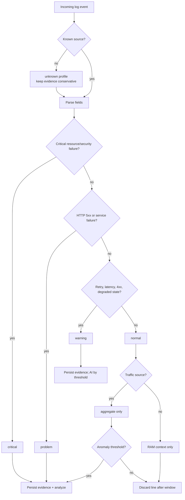

# Log Classifier Implementation Plan

> **For agentic workers:** REQUIRED SUB-SKILL: Use superpowers:subagent-driven-development (recommended) or superpowers:executing-plans to implement this plan task-by-task. Steps use checkbox (`- [ ]`) syntax for tracking.

**Goal:** Classify incoming logs quickly on the Server, keep normal traffic out of persistent evidence storage, and send only useful problem evidence to AI.

**Architecture:** The classifier uses two independent labels: `signal_type` describes what the log is about (`traffic`, `application`, `database`, `proxy`, `system`, `security`, or `unknown`), while `severity` describes impact (`normal`, `warning`, `problem`, or `critical`). Deterministic rules run first for every event; AI is reserved for ambiguous or correlated problem evidence. The Agent remains a read-only shipper and does not decide retention or call the LLM.

**Tech Stack:** Python server classifier, existing normalized event envelope, SQLite for retained evidence, bounded RAM rolling buffer for normal context, Go Agent unchanged in this phase, unittest.

## Global Constraints

- Agent only reads and sends; it never executes Server instructions as shell commands.
- The system never writes, deletes, truncates, or rotates files on client machines.
- Normal events are RAM-only and are not written to SQLite or raw JSONL archive.
- Warning, problem, and critical events are persisted as evidence and may create incidents.
- Every buffer, query, classification, and AI analysis is isolated by `website_id`.
- AI receives problem evidence plus bounded relevant context, not the complete normal traffic stream.
- A classifier rule must be deterministic, explainable, and include a rule identifier in event metadata.
- Log messages and metadata are bounded before classification and before AI prompt construction.

---

## Classification Contract

Each normalized event must contain:

```json
{
  "signal_type": "database",
  "severity": "problem",
  "category": "db_too_many_connections",
  "classification": {
    "rule_id": "db.connection_limit.v1",
    "confidence": 0.98,
    "basis": ["message_keyword", "service_name"]
  }
}
```

Precedence is fixed and tested: `critical` resource/security failures first, then explicit service failures and HTTP 5xx, then database/proxy/application problems, then warnings, then normal traffic. A status code alone must not override a stronger explicit error signal.

## Source Profiles

The Server maps `service`, `log_type`, `file_path`, and registered source metadata to profiles:

- Nginx/Apache: `proxy` or `application`; access logs are `traffic`, error logs are `proxy`.
- HAProxy: `proxy`; frontend/backend request lines are `traffic`.
- MariaDB/MySQL/PostgreSQL: `database`.
- Redis: `database`.
- Ubuntu syslog/journal/kernel: `system`.
- Authentication/audit logs: `security`.
- Unknown sources remain `unknown`; they are never silently treated as traffic.

## Retention Routing

| Classification | RAM buffer | SQLite/events | Raw archive | AI |
|---|---:|---:|---:|---:|
| traffic + normal | yes | no | no | no |
| normal non-traffic | yes | no | no | no |
| warning | yes, as context | yes | yes | only when policy/threshold says so |
| problem/critical | yes, then attach context | yes | yes | yes, after evidence grouping |

## System Flow Diagram

```mermaid
flowchart LR
    A[Client Agent\nRead-only tail] -->|HTTP events\nwebsite + agent + source| B[Server Ingest]
    B --> C[Normalize event]
    C --> D[Source profile\nservice/path/parser]
    D --> E[Deterministic classifier]

    E -->|traffic + normal| F[Traffic Monitor\nbounded counters]
    F -->|threshold breach| G[Traffic problem event]
    E -->|normal non-traffic| H[RAM rolling buffer]
    E -->|warning/problem/critical| I[Evidence pipeline]
    G --> I

    H -->|same source context| I
    I --> J[SQLite incidents/events]
    I --> K[Per-source raw archive]
    I --> L[Alert notification]

    J --> M[Targeted retrieval\nwebsite isolated]
    H --> M
    M --> N{Evidence sufficient?}
    N -->|yes| O[AI Core\nroot cause + action]
    N -->|no / ambiguous| P[More bounded retrieval\nrelated agents same website]
    P --> O
    O --> Q[Incident memory\nfuture matching]
    Q --> R[Dashboard + alert]
```



## Decision Flow



---

### Task 1: Freeze the classifier contract with tests

**Files:**
- Create: `test/server/test_log_classifier.py`
- Modify: `server/server/app/core.py`

**Interfaces:**
- Consumes: normalized event fields `service`, `log_type`, `file_path`, `message`, `status_code`, and optional explicit `severity`.
- Produces: `classify_event(event) -> dict[str, Any]` with `signal_type`, `severity`, `category`, and `metadata.classification`.

- [ ] **Step 1: Write failing tests** for Nginx 200 access traffic, Nginx upstream timeout, MariaDB connection exhaustion, HAProxy 503, kernel OOM, auth failure, warning retry, and unknown source.
- [ ] **Step 2: Run the focused test file** and verify the assertions fail because `signal_type` and rule metadata do not exist yet.
- [ ] **Step 3: Implement the smallest rule tables and precedence order** in a focused classifier module, keeping `core.py` responsible only for event normalization and public classification entry points.
- [ ] **Step 4: Run the focused tests** and verify every category and severity is stable.
- [ ] **Step 5: Commit** with `feat: add deterministic log classification contract`.

### Task 2: Add source profiling and parsing helpers

**Files:**
- Create: `server/server/app/log_profiles.py`
- Create: `server/server/app/log_parsers.py`
- Modify: `server/server/app/core.py`
- Test: `test/server/test_log_profiles.py`
- Test: `test/server/test_log_parsers.py`

**Interfaces:**
- `profile_source(event) -> dict[str, Any]` returns `service_class`, `source_kind`, and `traffic_candidate`.
- `parse_signal_fields(event) -> dict[str, Any]` returns extracted status code, request method/path, latency, and database error code when available.

- [ ] **Step 1: Write failing tests** for the known paths `/var/log/nginx/access.log`, `/var/log/nginx/error.log`, `/var/log/mysql/error.log`, HAProxy journal metadata, and syslog.
- [ ] **Step 2: Run focused tests** and confirm profile/parser functions are missing or return incomplete fields.
- [ ] **Step 3: Implement bounded regex and JSON parsing** with no filesystem access and no unbounded message splitting.
- [ ] **Step 4: Connect profile and parser output to classification metadata** without changing the Agent protocol.
- [ ] **Step 5: Run focused plus existing core tests** and commit `feat: profile and parse known log sources`.

### Task 3: Separate traffic monitoring from problem evidence

**Files:**
- Create: `server/server/app/traffic_monitor.py`
- Modify: `server/server/app/app_handlers.py`
- Modify: `server/server/app/storage_events.py` only if a small query helper is required
- Test: `test/server/test_traffic_monitor.py`
- Test: `test/server/test_http_api.py`

**Interfaces:**
- `TrafficMonitor.observe(event) -> TrafficSignal | None` updates bounded counters/windows and emits a signal only for configured anomalies.
- `TrafficMonitor.snapshot(website_id, agent_id=None) -> dict[str, Any]` returns request count, error rate, status distribution, and latency summary.

- [ ] **Step 1: Write failing tests** proving 200 access lines do not create events/incidents, while a 5xx-rate threshold creates one traffic signal with a cooldown key.
- [ ] **Step 2: Run focused tests** and confirm the monitor is absent.
- [ ] **Step 3: Implement a bounded time-window counter** keyed by website, agent, source, and route group; never retain every access line.
- [ ] **Step 4: Route traffic events before evidence storage** and convert only threshold breaches into problem evidence.
- [ ] **Step 5: Test burst traffic, multiple websites, and cooldown behavior; commit `feat: add traffic anomaly monitor`.

### Task 4: Make AI retrieval consume classified evidence only

**Files:**
- Modify: `server/server/app/analysis.py`
- Modify: `server/server/app/rolling_buffer.py`
- Test: `test/server/test_ai_core.py`
- Test: `test/server/test_http_api.py`

**Interfaces:**
- `build_ai_report(store, website_id, ...)` receives only warning/problem/critical evidence plus same-source bounded context and related agents from the same website.
- `build_context_evidence(events, limit=40) -> list[dict[str, Any]]` strips irrelevant fields and enforces prompt size.

- [ ] **Step 1: Write failing tests** proving normal traffic is excluded, same-source context is included, another website is excluded, and the primary failing machine is analyzed first.
- [ ] **Step 2: Run focused AI tests** and verify normal events can still enter the prompt through old retrieval paths.
- [ ] **Step 3: Implement severity/signal filtering and prompt-size limits** while preserving incident memory and root-cause fields.
- [ ] **Step 4: Run all AI and HTTP tests** and inspect one generated mock report for evidence correctness.
- [ ] **Step 5: Commit `feat: restrict AI retrieval to classified evidence`.

### Task 5: Add configuration and dashboard visibility

**Files:**
- Modify: `server/server/ai.yaml`
- Modify: `server/server/app/ai_settings.py`
- Modify: `server/server/app/ui.py`
- Test: `test/server/test_ai_settings.py`
- Test: `test/server/test_dashboard_admin.py`

**Configuration:**

```yaml
classification:
  enabled: true
  traffic_error_rate_percent: 5
  traffic_window_seconds: 60
  traffic_cooldown_seconds: 300
  ai_ambiguous_threshold: 0.65
```

- [ ] **Step 1: Write failing tests** for defaults, validation, and display of `signal_type`, `category`, and rule confidence.
- [ ] **Step 2: Implement settings validation** with bounded numeric values and safe defaults.
- [ ] **Step 3: Add filter/display support** to Log Explorer and Website Detail without bringing normal traffic rows back into the evidence table.
- [ ] **Step 4: Run the dashboard/settings tests** and verify existing page separation remains intact.
- [ ] **Step 5: Commit `feat: expose classifier settings and evidence labels`.

### Task 6: Full verification and deployment checkpoint

**Files:**
- Modify: `README.md`
- Modify: `docs/superpowers/specs/2026-07-31-log-classifier-design.md` if the final contract changes
- Test: existing `test/server`, `test/agent`, and Go checks

- [ ] **Step 1: Run Server unittest discovery** and require all tests to pass.
- [ ] **Step 2: Run Agent installer tests and `go test`, `go vet`, and `go build`**.
- [ ] **Step 3: Run a local smoke scenario** with access 200s, MariaDB error, Nginx timeout, and HAProxy 503 across two websites; verify storage and AI evidence boundaries.
- [ ] **Step 4: Review generated files for secrets and runtime data** before Git staging.
- [ ] **Step 5: Commit the verified release checkpoint and only then prepare the Podman deployment update.

## Self-Review

- The plan separates deterministic classification, traffic anomaly detection, evidence retention, and AI analysis into independent testable tasks.
- Normal traffic is explicitly excluded from SQLite, raw archive, and AI prompts.
- Website isolation and Agent read-only boundaries are repeated as global constraints and tested in Tasks 3 and 4.
- Memory growth is bounded at both per-source and global levels; traffic uses aggregates instead of line retention.
- No task requires the Agent to execute remote commands or write client Log files.
