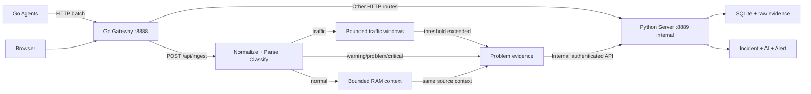

# Go Log Gateway Design

## Purpose

Move the high-volume Log data path out of Python while keeping the existing Dashboard, Incident, configuration, alerting, and AI features in Python. Agents and users continue to use one LAN URL and one exposed port.

## Architecture



Podman exposes only Go port `8888` to the LAN. Python listens on port `8889` inside the compose network and is not published on the host.

## Responsibilities

### Go Gateway

- Accept Agent and browser connections on port `8888`.
- Handle `POST /api/ingest` without forwarding normal events to Python.
- Support single events first and bounded batches after compatibility is proven.
- Normalize source identity and parse known Nginx, HAProxy, MariaDB, system, and authentication formats.
- Assign `signal_type`, `severity`, `category`, `rule_id`, and confidence.
- Keep normal context in bounded RAM by website, agent, and source.
- Aggregate traffic into bounded counters rather than storing every request line.
- Deduplicate evidence using a bounded time window.
- Forward retained evidence to Python through an internal authenticated endpoint.
- Reverse proxy every route other than owned ingestion/health routes to Python.
- Return compatible Agent responses so existing deployments can migrate without changing the Server URL.

### Python Server

- Remain the control plane for registration, heartbeat, source inventory, settings, login, and Dashboard.
- Persist only warning, problem, critical, traffic anomaly, and Agent data-loss evidence.
- Build incidents, retrieve website-isolated evidence, call AI, send notifications, and maintain incident memory.
- Keep the existing Python classifier as a fallback for manual import and direct internal tests, not as the primary live ingestion path.

### Go Agent

- Continue reading host Logs read-only.
- Continue using one `server.url` value.
- Initially send the existing single-event envelope; batch and compression are a later compatible enhancement.
- Never receive or execute shell commands.

## Public Routing

| Route | Owner | Behavior |
|---|---|---|
| `POST /api/ingest` | Go | Classify, buffer, aggregate, and forward evidence only |
| `GET /health` | Go | Report Gateway health plus degraded Python status |
| `GET /api/system/health` | Python via Go | Existing application health |
| `/api/agents/*` | Python via Go | Registration and heartbeat remain unchanged |
| `/api/log-sources*` | Python via Go | Source inventory remains unchanged |
| `/api/incidents*` | Python via Go | Incident management remains unchanged |
| `/api/analyze*` | Python via Go | AI analysis remains unchanged |
| `/`, `/login`, `/static/*`, page routes | Python via Go | Browser UI reverse proxied unchanged |

The Gateway strips inbound internal-auth headers before proxying. Only the Gateway may add the evidence-forwarding credential.

## Event Contract

The external Agent envelope remains compatible. The internal evidence envelope adds classification and context:

```json
{
  "schema_version": 1,
  "website_id": "website_1",
  "agent_id": "db1",
  "source_id": "src_mariadb_error",
  "timestamp": "2026-07-31T10:00:00Z",
  "message": "Too many connections",
  "signal_type": "database",
  "severity": "problem",
  "category": "db_too_many_connections",
  "classification": {
    "rule_id": "db.connection_limit.v1",
    "confidence": 0.98,
    "basis": ["service_name", "source_path", "message_keyword"]
  },
  "context_before": [],
  "gateway_event_id": "evt_..."
}
```

Python validates `schema_version`, required routing identity, severity, body size, context count, and message length before persistence.

## Classification and Retention

Classification uses two independent labels:

- `signal_type`: `traffic`, `application`, `database`, `proxy`, `system`, `security`, or `unknown`.
- `severity`: `normal`, `warning`, `problem`, or `critical`.

Routing is fixed:

| Result | RAM | Python/SQLite | Raw evidence | AI |
|---|---:|---:|---:|---:|
| normal traffic | aggregate/context only | no | no | no |
| normal non-traffic | context only | no | no | no |
| warning | context and evidence | yes | yes | policy threshold |
| problem/critical | context and evidence | yes | yes | yes |
| traffic threshold breach | evidence | yes | yes | yes |

Unknown normal sources remain RAM-only but are labelled with low confidence. Unknown problem signals are retained conservatively.

## Memory Limits

- Normal context lifetime: 5 minutes.
- Maximum normal events per website/agent/source: 200.
- Maximum context lines attached to one evidence event: 20.
- Maximum total normal events in the Gateway: 20,000.
- Maximum source partitions: 2,048.
- Maximum parsed message length: 8 KiB.
- Maximum internal evidence request body: 1 MiB.
- Traffic windows store counters and bounded route groups, not request lines.

Limits are configuration values with the values above as defaults. Global limits always override per-source limits.

## Traffic Monitoring

The first traffic monitor uses a 60-second rolling window per website, agent, source, and normalized route group. It tracks request count, HTTP status groups, and latency samples as bounded aggregates.

A traffic problem is emitted when all conditions hold:

- At least 20 requests exist in the window.
- HTTP 5xx rate is at least 5 percent, or p95 latency exceeds the configured limit.
- The same anomaly fingerprint is not inside its 300-second cooldown.

Traffic thresholds are configurable from Python settings and delivered to Go through an internal policy endpoint. Go retains the last known valid policy in memory; a restart starts with compiled safe defaults until Python is reachable.

## Failure Behavior

### Python unavailable

- Gateway health becomes `degraded`.
- Dashboard/control requests return `503` after a short proxy timeout.
- Normal Log processing and traffic aggregation continue.
- Retained evidence enters a bounded disk spool owned by the Gateway container.
- The spool has a byte limit and oldest-first loss markers; it never grows without bound.
- Evidence is retried with exponential backoff and idempotency keys when Python returns.

### Gateway restart

- RAM normal context and traffic windows are intentionally cleared.
- Evidence already accepted into the disk spool survives through a dedicated volume.
- Agents retry using their existing local spool behavior.

### Invalid event

- Gateway returns `400` for malformed envelopes and `413` for oversized requests.
- Authentication failures return `401` without forwarding to Python.
- Invalid events are counted in metrics but their full messages are not written to operational logs.

## Security

- LAN exposure remains one port: `8888`.
- Existing enrollment and Agent tokens remain authoritative in Python.
- Go validates Agent tokens through a bounded local cache backed by an internal Python validation endpoint.
- Cache entries expire and fail closed for unknown or expired agents.
- Gateway-to-Python evidence uses a dedicated secret mounted through `secrets.env` and compared in constant time.
- Internal Python port `8889` is not published to the host.
- Request bodies, response bodies, proxy timeouts, headers, and concurrent connections are bounded.
- No component accepts remote shell commands or writes host Log files.

## Deployment Layout

```text
server/
  compose.yaml
  gateway/
    cmd/gateway/main.go
    internal/classifier/
    internal/parser/
    internal/profile/
    internal/traffic/
    internal/buffer/
    internal/forwarder/
    internal/proxy/
  server/
    app/                  # existing Python control and AI application
```

The Go Gateway and Python Server use separate Containerfiles. Compose starts Python first, then Gateway health checks Python and exposes port `8888`.

## Migration

1. Add the Go Gateway with reverse proxy only and prove existing UI, login, registration, heartbeat, and ingest compatibility.
2. Enable Go classification in shadow mode while Python remains authoritative; compare results without duplicate persistence.
3. Enable evidence-only forwarding and stop normal persistence through the live path.
4. Enable traffic aggregation and anomaly evidence.
5. Add Agent batching and gzip as a backward-compatible optimization.
6. Deploy to the test Server and two MariaDB Agents before expanding to more machines.

Rollback changes compose routing back to the Python container. Existing Agent configuration and stored incidents remain valid.

## Testing and Acceptance

- Golden classification tests cover Nginx, HAProxy, MariaDB, system, authentication, and unknown sources.
- Contract tests send the same payload to Go and the Python fallback and compare normalized classifications during shadow mode.
- Proxy tests verify login cookies, static files, uploads, query strings, and streaming-safe bounded responses.
- Isolation tests prove no context, traffic counter, evidence, or AI retrieval crosses `website_id`.
- Concurrency tests simulate at least 50 Agents and verify bounded memory and no race detector findings.
- Failure tests stop Python, fill and drain the evidence spool, restart Gateway, and verify idempotent recovery.
- Full Python tests, Go tests, `go vet`, `go test -race`, builds, and Podman smoke tests must pass before deployment.

The first production-ready milestone is complete when existing Agents use the unchanged URL, normal Log lines do not reach Python, evidence survives a temporary Python outage, and the Dashboard/AI behavior remains available through the Gateway.
